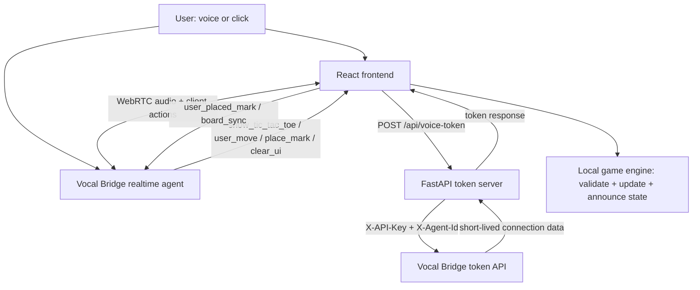

# VocalGrid — Voice-Controlled Tic-Tac-Toe

A standalone, GitHub-ready teaching project that combines a **React/Vite Tic-Tac-Toe web app**, a **FastAPI token server**, and **Vocal Bridge bidirectional client actions**. This project is based on the supplied Vocal Bridge Lesson 2 files, but is extracted from Jupyter into maintainable modules. It also adds a polished UI, offline/demo play mode, game-state validation, tests, diagnostics, and GitHub Actions.

> **Status:** The local game and Python API can be tested without Vocal Bridge credentials. Real conversational voice **requires** a Vocal Bridge account, API key, configured agent, reachable Vocal Bridge service, and microphone permission. The ZIP does not contain credentials and is not an already deployed voice service. This is a learning/demo application, not a production-hardened auth service.

## Table of contents

1. [Features](#features)
2. [How it works](#how-it-works)
3. [Repository structure](#repository-structure)
4. [Prerequisites](#prerequisites)
5. [Fast start: local game without voice](#fast-start-local-game-without-voice)
6. [Full setup: voice mode](#full-setup-voice-mode)
7. [Use the app](#use-the-app)
8. [Client actions and data flow](#client-actions-and-data-flow)
9. [Code walkthrough](#code-walkthrough)
10. [Testing](#testing)
11. [Troubleshooting](#troubleshooting)
12. [Security and production notes](#security-and-production-notes)
13. [Create your GitHub repository](#create-your-github-repository)
14. [Design decisions and limitations](#design-decisions-and-limitations)
15. [Resources](#resources)

## Features

- Voice commands such as **"Let's play tic-tac-toe"**, **"center"**, **"top left"**, and **"clear"** through Vocal Bridge.
- Click-to-play input: user clicks send a `user_placed_mark` event to the agent, which should answer with a `place_mark` counter-move.
- Agent-to-app actions for opening the board, playing a move, or clearing the interface.
- A complete authoritative board state sent back to the agent as `board_sync` on successful moves and new matches.
- Hard validation for invalid squares, occupied squares, wrong turn, and attempts to move after a win/draw.
- Separate local demo mode: play against a deterministic local bot with **no account, API key, microphone, Python server, or external service**.
- Live activity log and transcript display; responsive dark-themed layout.
- FastAPI endpoint for short-lived session tokens, with credentials kept in the backend.
- Unit tests for the game engine and backend API, plus CI workflow.

## How it works



**Division of responsibility:** Vocal Bridge does speech transport and agent conversation; React owns the board and validates every action; FastAPI mints credentials only. No database is used. `board_sync` is a **notify** event; `user_placed_mark` is a **respond** event.

### Spoken versus clicked moves

**Spoken:** User says "center" → agent issues `user_move` `{row:1,col:1}` then `place_mark` for O in the same response → frontend validates each action, applies allowed moves, and publishes `board_sync` after each accepted move. The prompt requests both actions in the same agent response, as in the course; the frontend validates them individually and reports actual state. If the first move is rejected, the counter-move is also rejected by turn validation.

**Clicked:** User clicks square 5 → frontend validates and places X → sends `user_placed_mark` with full board (`respond`) and `board_sync` (`notify`) → agent sends `place_mark` for O → frontend validates and syncs.

**Demo mode:** Clicking a square updates the game and a local deterministic bot chooses an available response. Vocal Bridge is not involved. It uses the same `makeMove` validation rules.

## Repository structure

```text
voice-tic-tac-toe/
├── README.md                      # You are here
├── LICENSE                        # MIT
├── .gitignore                     # Excludes secrets, env, artifacts
├── .github/workflows/ci.yml       # Frontend + backend checks
├── agent/
│   ├── actions.json               # Original six client-action declarations
│   ├── prompt.md                  # Revised standalone agent prompt
│   ├── course-prompt-original.md  # Lesson's original prompt (comparison)
│   └── README.md                  # Prompt/contract notes
├── backend/
│   ├── .env.example               # Configuration template
│   ├── requirements.txt           # Runtime dependencies
│   ├── requirements-dev.txt       # Test dependencies
│   ├── app/
│   │   ├── __init__.py
│   │   └── main.py                # FastAPI token endpoint
│   └── tests/test_api.py          # Mocked token API tests
└── frontend/
    ├── package.json              # React, SDK, Vite, Vitest
    ├── vite.config.js             # React plugin, /api -> :8000 proxy
    ├── index.html
    └── src/
        ├── main.jsx
        ├── App.jsx                # Demo and Live Voice modes
        ├── styles.css
        ├── components/
        │   ├── GameView.jsx       # Board, controls, transcript, activity log
        │   └── VoiceGame.jsx      # Vocal Bridge provider/action subscriptions
        ├── hooks/
        │   └── useGameController.js  # State & events for click or voice
        └── game/
            ├── engine.js          # Pure game logic (no voice dependency)
            └── engine.test.js     # Game-engine unit tests
```

## Prerequisites

- **Node.js 20.19+ or 22+** and npm (modern Vite toolchain).
- **Python 3.10+** (3.11 or 3.12 recommended) and pip for voice backend.
- **Vocal Bridge account** and API key for real voice mode.
- Modern browser with microphone support; use **localhost** during development or **HTTPS** when deployed.
- Optional: `git` and GitHub account for publishing.

> **SDK compatibility:** The uploaded course's `helpers.py` pins `@vocalbridgeai/react@0.1.1` and `@vocalbridgeai/sdk@0.1.1`. This project uses those exact versions and the course's `const {onAction,sendAction} = useAgentActions()` hook contract. Vocal Bridge's public website also shows newer alternate hook examples; if you upgrade the SDK, confirm the provider and client-action APIs before changing versions. **Live SDK integration has not been independently verified here against an actual Vocal Bridge session.**

## Fast start: local game without voice

The fastest way to confirm the game works requires only Node.js:

```bash
cd voice-tic-tac-toe/frontend
npm install
npm run dev
```

Open **http://127.0.0.1:5173** in your browser. Keep **Local Demo** selected. Click **New game**, then select a square. The local bot plays O. Play again, clear the board, or browse the activity log. No backend configuration is needed.

The **Live Voice** tab requires the following extra setup.

## Full setup: voice mode

### 1. Create and activate a Python environment

From the repository root:

**macOS / Linux**

```bash
cd backend
python3 -m venv .venv
source .venv/bin/activate
pip install -r requirements.txt
```

**Windows PowerShell**

```powershell
cd backend
py -m venv .venv
.venv\Scripts\Activate.ps1
pip install -r requirements.txt
```

### 2. Create the agent on Vocal Bridge

Use the Vocal Bridge dashboard, or the CLI (documented in the original course). Install the CLI if necessary:

```bash
pip install vocal-bridge
vb auth login
```

From the **repo root** (not `backend/`), run the course-style creation command:

```bash
vb agent create \
  --name vocalgrid-tic-tac-toe \
  --style Chatty \
  --prompt-file agent/prompt.md \
  --client-actions-file agent/actions.json \
  --deploy-targets web
```

If your current CLI uses different flags, use `vb agent create --help`, `vb docs`, or the dashboard to create the equivalent agent. Ensure it is configured with **all six** client actions, correct directions, and `respond` / `notify` behaviors. **Save the agent ID** from the creation result; an agent name is not necessarily its ID.

If the agent already exists, update its prompt/actions in the dashboard or with the appropriate `vb` CLI configuration command, rather than creating duplicates. See [official documentation](https://vocalbridgeai.com/docs/overview).

### 3. Configure your backend environment

From `backend/`:

**macOS / Linux**

```bash
cp .env.example .env
```

**Windows PowerShell**

```powershell
Copy-Item .env.example .env
```

Edit `backend/.env`:

```dotenv
VOCAL_BRIDGE_API_KEY=YOUR_REAL_API_KEY
VOCAL_BRIDGE_AGENT_ID=YOUR_REAL_AGENT_ID
VOCAL_BRIDGE_API_URL=https://vocalbridgeai.com
CORS_ORIGINS=http://localhost:5173,http://127.0.0.1:5173
TOKEN_RATE_LIMIT_PER_MINUTE=10
```

**Do not** paste API secrets into frontend code. `.env` is excluded by `.gitignore`. The frontend receives only a short-lived session token.

### 4. Start FastAPI (terminal A)

```bash
cd backend
source .venv/bin/activate   # macOS/Linux; Windows: .venv\Scripts\Activate.ps1
uvicorn app.main:app --reload --host 127.0.0.1 --port 8000
```

Check the health endpoint:

```bash
curl http://127.0.0.1:8000/api/health
```

Expected shape:

```json
{"status":"ok","voice_configured":true}
```

`voice_configured:true` only means both environment values are present; it does **not** validate that the key, agent or upstream service works.

### 5. Start React (terminal B)

```bash
cd frontend
npm install
npm run dev
```

Open **http://127.0.0.1:5173**. Choose **Live Voice**, press **Connect voice**, and accept the microphone permission request. Try "Let's play tic-tac-toe", "center", "top left", and "clear". The app displays action events as well as the live transcript when provided by the SDK.

### 6. Confirm the end-to-end flow

1. The web app calls the local `/api/voice-token` URL (Vite proxies to FastAPI).
2. FastAPI calls `POST https://vocalbridgeai.com/api/v1/token` with `X-API-Key` and `X-Agent-Id`.
3. The backend returns normalized `url`, `token`, and `room_name` fields to the browser.
4. The browser connects with the SDK's custom `tokenProvider`.
5. When the agent emits `show_tic_tac_toe`, the board appears.
6. When you say a square, `user_move` is handled; the client sends `board_sync`.
7. When you click a square, `user_placed_mark` and `board_sync` are sent; the agent can reply with `place_mark`.

## Use the app

| Control | Local demo | Live voice |
| --- | --- | --- |
| New game | Resets the board | Resets locally and sends `board_sync` when connected |
| Click empty square | Plays X; local bot counters | Plays X; broadcasts `user_placed_mark` + `board_sync` |
| Connect voice | Unavailable | Connects to your configured Vocal Bridge agent |
| Say “let's play” | Unavailable | Agent sends `show_tic_tac_toe` |
| Say “center” | Unavailable | Agent sends `user_move` with `{row:1,col:1}` |
| Clear board | Resets locally | Resets locally and sends idle `board_sync` (agent's `clear_ui` does the same) |
| Activity stream | Shows board events | Shows board and incoming agent actions |
| Live transcript | No transcript | Shows transcript when SDK supplies it |

A voice agent may not know about clicking **New game** unless it receives the resulting `board_sync`. Thus the local board is always authoritative, and the voice agent is expected to follow its latest snapshot.

## Client actions and data flow

The six action names and directions are preserved from the supplied course. The `agent/actions.json` descriptions are human-readable and do not define a separate JSON Schema `parameters` field; refer to the platform configuration if your current account/version requires stronger payload schemas.

| Action | Direction | Example payload | Trigger |
| --- | --- | --- | --- |
| `show_tic_tac_toe` | agent → app | `{"userSymbol":"X","firstTurn":"user"}` | Spoken start/rematch |
| `user_move` | agent → app | `{"row":1,"col":1,"heard":"center"}` | User speaks location |
| `place_mark` | agent → app | `{"row":0,"col":0}` | Agent's counter-move |
| `clear_ui` | agent → app | `{}` | User says "clear" |
| `user_placed_mark` | app → agent, `respond` | `{board,status,turn,moveCount,userSymbol,agentSymbol,revision,position,row,col,mark}` | User mouse click |
| `board_sync` | app → agent, `notify` | `{board,status,turn,moveCount,userSymbol,agentSymbol,revision}` | New match, accepted move, or clear |

Coordinates in actions are **zero-based**. Board array is row-major and holds 9 elements (`"X"`, `"O"`, or `null`). A failed move does not change the board or advance the turn; it is recorded in the activity panel.

```text
Indexes:          Example board:
0 | 1 | 2         X | - | -
--+---+--         --+---+--
3 | 4 | 5         - | O | -
--+---+--         --+---+--
6 | 7 | 8         - | - | -
```

### Why `revision` exists

Every accepted move increments the revision. This helps developers identify stale updates or repeated events during debugging. The current frontend does not perform distributed ordering or deduplicate upstream action IDs; the turn and occupancy validation do reduce accidental invalid moves. For production-grade reliability, use action IDs and acknowledgements with a single ordered command queue.

## Code walkthrough

**`frontend/src/game/engine.js`**: pure functional rules: `newGame`, `makeMove`, `winnerOf`, `snapshot`, `parsePosition`, `chooseAgentMove`. The game never trusts the agent to define the outcome.

**`frontend/src/hooks/useGameController.js`**: React state and latest-state ref. All inputs (voice, mouse, demo bot) call the same `move()`. Successful moves trigger state broadcasts; user clicks additionally trigger a response-producing event. Clearing also broadcasts idle state.

**`frontend/src/components/VoiceGame.jsx`**: Vocal Bridge provider with custom `tokenProvider`. It subscribes to the four agent-to-app events via `onAction()`, and publishes app-to-agent events through `sendAction()`.

**`frontend/src/components/GameView.jsx`**: UI only: accessible click targets, active player, banner, activity log, transcript, buttons.

**`backend/app/main.py`**: token minting. Reads API credentials server-side, calls the upstream token API, maps upstream `livekit_url` or `connection_url` to `url`, and returns SDK-compatible response. Error messages intentionally omit upstream response bodies.

## Testing

### Frontend unit tests

```bash
cd frontend
npm install
npm test
npm run build
```

Coverage includes legal/illegal moves, win and draw detection, choosing moves, and board snapshot behavior. A successful build checks that the app bundles, but is not a substitute for a live microphone/agent test.

### Backend API tests

```bash
cd backend
pip install -r requirements-dev.txt
PYTHONPATH=. pytest tests -q
```

On Windows PowerShell, `cd backend; python -m pytest tests -q` works because the current directory is on the Python module path. Tests mock the upstream service and never use a real Vocal Bridge key.

### Manual end-to-end checklist

- [ ] Local demo starts a match and bot responds.
- [ ] Invalid and occupied moves are rejected.
- [ ] Win/draw is detected and further moves are blocked.
- [ ] FastAPI health reports configuration state.
- [ ] Voice connects (microphone permission granted).
- [ ] Saying "let's play" opens board.
- [ ] Speaking "center" places X, syncs board, and agent counters with O.
- [ ] Clicking an empty square sends `user_placed_mark`; agent responds.
- [ ] Calling clear resets/hides the board.
- [ ] Transcript and activity stream update.
- [ ] API key never appears in frontend source, network token response, or git commits.

## Troubleshooting

| Symptom | Possible reason | Resolution |
| --- | --- | --- |
| `npm install` fails | Node version, npm registry connectivity, SDK version unavailable | Check `node -v` and internet access; verify `@vocalbridgeai/react@0.1.1` availability in your registry and adapt SDK integration if upgrading. |
| Health says `voice_configured:false` | Missing `.env` values | Copy `.env.example`, fill both credentials and restart FastAPI. |
| Token endpoint returns `503` | Backend not configured | Add `VOCAL_BRIDGE_API_KEY` and `VOCAL_BRIDGE_AGENT_ID`. |
| Token endpoint returns `502` | Upstream token API error, invalid credentials, timeout | Recheck the key/agent ID, agent deployment and service status; the API hides sensitive upstream details. |
| `404` on `/api/voice-token` | FastAPI not running or wrong Vite proxy | Start backend at `127.0.0.1:8000` and frontend at `127.0.0.1:5173`. |
| Browser won't use microphone | Permission denied or insecure origin | Allow mic in browser; use localhost or HTTPS. |
| Voice connects but board doesn't move | Missing action configuration, name mismatch, agent did not call tools | Verify all six actions in Vocal Bridge; compare dashboard logs with local Activity stream. |
| Voice move is rejected | Occupied cell, wrong turn, invalid coordinates, game already over | Check event log; speak an available cell during your turn. |
| Voice says move but no UI change | Voice response emitted without corresponding `user_move` / `place_mark` action | Make sure `agent/prompt.md` is deployed and actions configured; the UI will not simulate a move based on transcript text. |
| SDK hook differs | Platform SDK version changed | Use the pinned course SDK or update provider/action hooks together according to the version's docs. |
| Transcript is blank | Not connected or service didn't emit transcript events | Confirm connected state, speech and agent settings. |

## Security and production notes

**This is deliberately a local development/demo project.** The sample backend exposes a token endpoint without login to simplify learning. It uses only process-local, per-IP rate limiting, which is not sufficient for a publicly deployed service. Before deploying publicly:

1. Require authenticated sessions before token minting; authorize each request and use a shared rate limiter (e.g., Redis) behind your reverse proxy.
2. Do not leave API keys in browser code, `.env` commits, CI logs or screenshots; rotate any exposed key.
3. Restrict CORS to real deployment domains. Note that CORS does not prevent server-to-server requests; authentication is still required.
4. Serve frontend/backend through HTTPS (and secure WebRTC); limit session lifetimes and per-account token creation.
5. Validate actions on the client and sensitive operations on the backend; avoid treating LLM decisions as trusted inputs.
6. Avoid storing recordings or personal transcripts unless necessary, and define retention/privacy rules.
7. Add structured telemetry, action IDs, acknowledgments, ordering, replay protection, and end-to-end testing with actual Vocal Bridge infrastructure.

## Create your GitHub repository

This ZIP contains a full **repository structure**, not an already-hosted GitHub URL. Create an empty GitHub repo at [github.com/new](https://github.com/new). **Do not** initialize it with an extra README or license (these are already included).

From the extracted repository directory:

```bash
git init
git add .
git commit -m "Initial release: Vocal Bridge voice Tic-Tac-Toe"
git branch -M main
git remote add origin https://github.com/YOUR_USERNAME/voice-tic-tac-toe.git
git push -u origin main
```

Or use GitHub CLI if installed and authenticated:

```bash
git init
git add .
git commit -m "Initial release"
git branch -M main
gh repo create voice-tic-tac-toe --public --source=. --remote=origin --push
```

Ensure `backend/.env` is never committed. GitHub Actions automatically runs frontend tests, build, and backend tests on pushes and pull requests. For production hosting you will also need a frontend hosting provider, an HTTPS backend, configured CORS, and public-token endpoint authentication.

## Design decisions and limitations

- **Same action protocol as lesson:** six action names are retained for easy comparison.
- **Course-compatible voice sequencing:** spoken moves request `user_move` followed by `place_mark` in one agent response. The client validates each move and rejects invalid actions; this approach does not guarantee perfect recovery from an invalid spoken move.
- **State owned by React:** no database and no server-side move endpoint. Refreshing page resets a match.
- **Offline demo uses deterministic bot:** actual AI strategy only exists in Vocal Bridge voice mode.
- **Live SDK behavior not tested against credentials in this package:** setup requires your own service account and configuration.
- **Version-pinned SDK:** prevents unreviewed drift from the supplied lesson, but check package availability/compatibility before production deployment.
- **No actual remote repository created automatically:** follow the GitHub commands above.

## Resources

- [Vocal Bridge developer docs](https://vocalbridgeai.com/docs/overview)
- [Vocal Bridge](https://vocalbridgeai.com/)
- [React](https://react.dev/)
- [Vite](https://vite.dev/)
- [FastAPI](https://fastapi.tiangolo.com/)

### Attribution

Derived as an educational standalone reimplementation of the user's supplied **Vocal Bridge Lesson 2 — Voice in your App** notebook and its `helpers.py`, `prompt.md`, and `actions.json`. The `agent/course-prompt-original.md` file preserves the supplied course prompt for study. This repository is an independent learning project and is not an official Vocal Bridge product.
